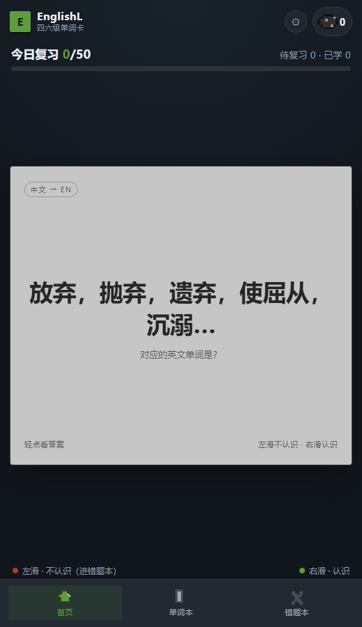
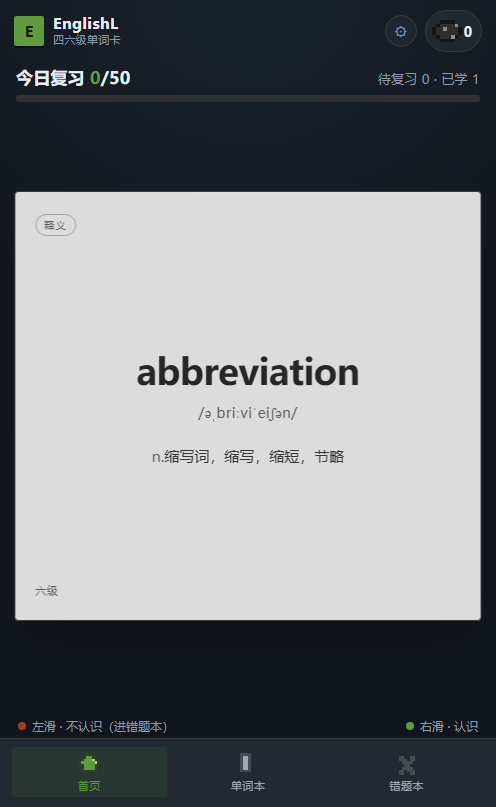
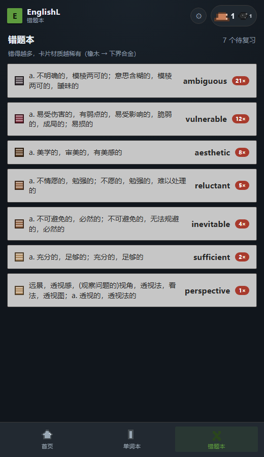
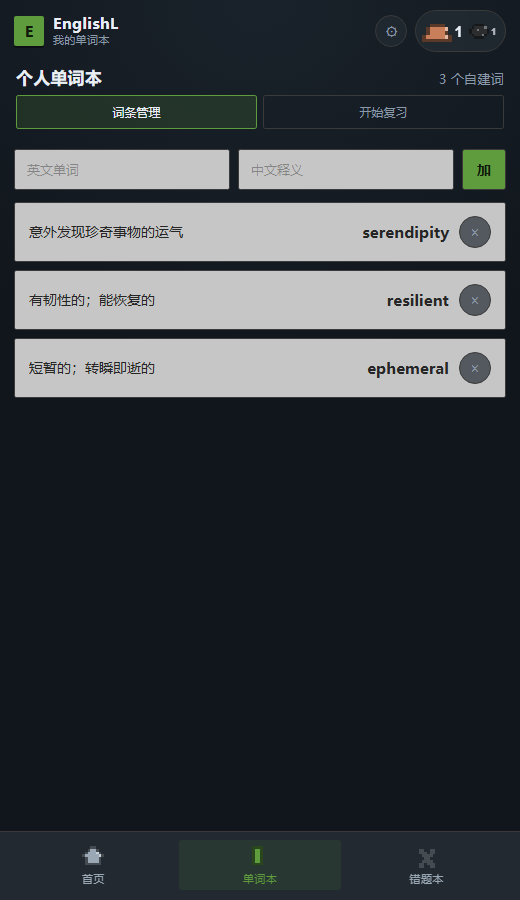

# EnglishL · 四六级单词卡


一个**离线优先**的四六级单词记忆应用：滑动判定熟不熟、艾宾浩斯间隔复习、错题本、
进位制段位养成，配可替换主题（我的世界 / 极简）。

同一套代码既可以当 **手机网页（PWA）** 用，也可以打包成 **Android APK**。

---

## 预览

| 首页滑卡 | 翻面释义 | 错题本 |
| :---: | :---: | :---: |
|  |  |  |

| 个人单词本 | 模拟器运行 |
| :---: | :---: |
|  |  |

---

## 功能特性

- **卡片式记忆**：左滑「认识」、右滑「不认识」、长按「模糊」、轻点看答案；判定后翻面停住，点一下才进入下一张。
- **双向出题**：英文面 / 中文面各 50% 随机，中文面不会提前朗读答案。
- **艾宾浩斯调度**：按间隔重复（SRS）自动安排每个词的下次出现时间，答错快速回炉。
- **加权随机队列**：不按字母序；逾期越久权重越高、错得越多权重越高，已掌握的偶尔也会「冒头」。
- **进位制段位**：每天达标 +1 煤，10 煤 = 1 铜，10 铜 = 1 铁 … 右上角常驻徽章。
- **错题本**：自动收集判错的词，左中文右单词，错误次数越多卡片材质越稀有，左滑两次删除。
- **个人单词本**：自建词条，与主词库互不干扰，同样支持滑卡复习。
- **主题包**：配色 / 字体 / 段位材料名 / 错题材质 / 背景与装饰图全部由主题数据驱动。
- **完全离线**：5805 个词的词库随包内置，安装后断网可完整使用。
- **在线增量更新**：可选接静态托管，只下发差异补丁（几 KB）。
- **单词发音**：APK 走系统 TTS，浏览器走 Web Speech API。

---

## 技术栈

| 层次 | 选型 | 说明 |
| --- | --- | --- |
| 视图层 | **Vue 3**（`<script setup>` + Composition API） | 无 Vuex/Pinia，状态用 `reactive` 单例 |
| 构建 | **Vite 6** | 产物 `dist/`，`base: './'` 便于离线/壳内加载 |
| 语言 | **TypeScript** | 仅类型标注，构建不做类型检查（esbuild 直出） |
| 样式 | 原生 CSS + CSS 变量 | 主题通过 CSS 变量注入，无 UI 框架 |
| 状态与持久化 | `reactive` + **localStorage** | 单键 JSON，250ms 防抖写入 |
| 原生壳 | **Capacitor 6** | WebView + 原生桥，Android 工程在 `android/` |
| 原生能力 | `@capacitor/app`（返回键）、`@capacitor-community/text-to-speech`（发音） | |
| 离线缓存 | 手写 **Service Worker**（`public/sw.js`） | 页面 network-first，静态资源 cache-first |
| 词库构建 | **Python + Pillow / csv** | ECDICT 切片 → `src/data/words.json` |
| 图标生成 | **Python + Pillow** | 像素草方块 / 木棍 E，输出到 `res/mipmap-*` |
| 调试 | Chrome DevTools Protocol（自研脚本） | 手势回归、发音调用统计、WebView 状态检查 |

---

## 快速开始

### 环境要求

- Node.js ≥ 18（开发时使用 22）
- Python ≥ 3.9（只有重新生成词库 / 图标时才需要）
- 出 APK 额外需要：JDK 17+、Android SDK（Platform 34）

### 安装与开发

```bash
npm install
npm run dev        # http://127.0.0.1:5173
npm run dev:lan    # 同上，但监听 0.0.0.0，手机可用局域网访问
```

### 构建

```bash
npm run build      # 网页产物 -> dist/
npm run preview    # 本地预览生产构建
npm run apk        # 一键：build -> cap sync -> assembleRelease -> 拷贝到 releases/
```

### 安装到手机 / 模拟器

```bash
adb install -r releases/EnglishL-release.apk
```

或直接把 APK 拖进模拟器窗口。安装后在**应用抽屉**里找 `EnglishL`（不会自动放桌面）。

---

## 目录结构

```
EnglishL/
├── src/                        # 前端源码
│   ├── main.ts                 # 入口：挂载 App、预热语音、注册 SW
│   ├── App.vue                 # 布局、Tab 切换、弹层、返回键、主题变量注入
│   ├── config.ts               # 词库更新地址、主题图片总开关
│   ├── style.css               # 全部样式（含主题图片层）
│   ├── core/                   # 与界面无关的纯逻辑
│   │   ├── types.ts            # Word / SrsState / Grade 等类型
│   │   ├── srs.ts              # 间隔重复算法（三档评分）
│   │   ├── queue.ts            # 加权随机抽词
│   │   ├── rank.ts             # 进位制段位换算
│   │   ├── store.ts            # 全局状态、持久化、每日结算
│   │   ├── update.ts           # 词库增量更新
│   │   └── speech.ts           # 发音（原生 TTS / Web Speech）
│   ├── themes/themes.ts        # 主题包：颜色、材料表、错题材质、图片配置
│   ├── components/             # 可复用组件
│   │   ├── SwipeCard.vue       # 卡片：拖拽、翻面、长按、飞出
│   │   ├── RankBadge.vue       # 右上角段位徽章
│   │   ├── TabBar.vue          # 底部导航
│   │   ├── PixelIcon.vue       # 8×8 像素画渲染（段位图标）
│   │   ├── ThemeSheet.vue      # 设置弹层（发音 + 主题）
│   │   └── RankSheet.vue       # 段位详情弹层
│   ├── views/                  # 三个页面
│   │   ├── HomeView.vue        # 首页滑卡
│   │   ├── OwnView.vue         # 个人单词本
│   │   └── WrongView.vue       # 错题本
│   ├── data/
│   │   ├── words.json          # 5805 词（构建产物，勿手改）
│   │   └── words.ts            # 词库加载与类型化
│   └── dev/seed.ts             # 演示数据（仅开发环境 ?demo=1）
├── public/                     # 静态资源
│   ├── sw.js                   # Service Worker
│   ├── manifest.webmanifest    # PWA 清单
│   ├── themes/minecraft/       # 主题图片素材目录（可选）
│   └── mock/                   # 词库更新测试用假补丁
├── android/                    # Capacitor 生成的 Android 工程
├── tools/                      # 构建 / 调试脚本
├── docs/                       # 设计文档与截图
└── releases/                   # 本地 APK 产物（不入库）
```

---

## 核心代码说明

### 1. 三种手势与判定流程

`src/components/SwipeCard.vue`

| 手势 | 判定 | 行为 |
| --- | --- | --- |
| 左滑 | `know`（认识） | 间隔推进，计入当日达标 |
| 右滑 | `unknown`（不认识） | 间隔回落，加入错题本 |
| 长按 450ms | `fuzzy`（模糊） | 间隔小幅推进，不计达标、不进错题本 |
| 轻点 | — | 翻面看释义（不记录） |

判定后卡片先回弹、翻面显示释义，并进入 `pending` 状态**一直停留**，
用户点击后才执行飞出动画并 `emit('grade', ...)` 结算。

### 2. 记忆调度：`src/core/srs.ts`

每个词保存一份记忆状态：

```ts
interface SrsState {
  ease: number      // 难度系数 1.3 ~ 3.0
  interval: number  // 当前间隔（毫秒）
  due: number       // 下次到期时间戳
  mistakes: number  // 累计错误次数（答对会衰减）
  seen: number
  last?: number
}
```

三档评分对应的间隔变化：

```ts
// 认识：间隔 × 难度系数，首次 1 天，封顶 180 天
s.interval = base <= 0 ? DAY : Math.min(Math.round(base * s.ease), 180 * DAY)
s.ease = clamp(s.ease + 0.05, 1.3, 3)
s.mistakes = Math.max(0, s.mistakes - 0.25)   // 关键：练熟后错误权重回落

// 模糊：只推进 1.2 倍
s.interval = base <= 0 ? DAY : Math.min(Math.round(base * 1.2), 180 * DAY)

// 不认识：间隔 ×0.3，最多 1 天，最少 10 分钟
s.interval = Math.max(10 * MINUTE, Math.min(Math.round(base * 0.3), DAY))
s.mistakes += 1
```

连续答对时的间隔序列：`1 天 → 2.6 → 6.9 → 18 → 46 → 118 → 180（封顶）`。

### 3. 加权随机队列：`src/core/queue.ts`

不排序、不按字母序，而是**加权无放回抽样**（Efraimidis–Spirakis：`key = random^(1/weight)`）。

```ts
// 到期词：逾期越久权重越高
weight = 1 + Math.min(overdueDays, 12) * 0.5
// 未到期但学过的：保留极低权重，仍有概率冒头
weight = 0.04
// 错词加倍
weight *= 1 + mistakes * 0.9
```

新词进入独立的「新词池」，按每日配额（默认 12 个）随机抽取，每 4 张复习词插 1 张新词。

### 4. 进位制段位：`src/core/rank.ts`

```ts
// 累计煤数 -> 各数位（十进制）
breakdown(coals, materials) // 11 -> [铜 ×1, 煤 ×1]
```

- 每天「认识」累计 50 个 → `coals += 1`
- 某天未达标或未打开 → `coals -= 1`（向下借位）
- 材料表：煤炭 → 铜 → 铁 → 金 → 红石 → 青金石 → 绿宝石 → 钻石 → 下界合金 → 基岩
- 徽章显示：最高位大图标、低位自动缩小

### 5. 状态与持久化：`src/core/store.ts`

```ts
const KEY = 'englishl:state:v2'

// 所有状态放在一个 reactive 对象里
// watch(state, deep) -> 250ms 防抖 -> JSON.stringify 写入 localStorage
```

`pool` 是「内置词库 + 增量补丁」合并后的最终词表：

```ts
export const pool = computed(() => {
  const gone = new Set(state.wordOverrides.removed)
  return [
    ...CET_WORDS.filter((w) => !gone.has(w.id)).map((w) => state.wordOverrides.updated[w.id] ?? w),
    ...state.wordOverrides.added
  ]
})
```

### 6. 主题包：`src/themes/themes.ts`

一个主题 = 配色 + 段位材料表 + 错题材质梯度 + 图片配置，界面代码不认具体名字：

```ts
interface Theme {
  colors: Record<string, string>   // 注入为 CSS 变量
  materials: Material[]            // 段位进位用（煤炭/铜/铁…）
  mistakeLadder: MistakeMaterial[] // 错题次数 -> 卡片材质
  images?: ThemeImages             // 背景、面板、卡片框、段位图标、装饰图
}
```

### 7. 词库增量更新：`src/core/update.ts`

```
App 启动 -> GET version.json -> 本地版本落后？
        -> GET patch-<n>.json（只含新增 / 修改 / 删除）
        -> 合并进本地 -> 记下新版本号
```

断网、404、超时全部静默跳过，不影响启动。发布流程见 [docs/词库更新.md](docs/词库更新.md)。

### 8. 发音：`src/core/speech.ts`

```ts
const isNative = Capacitor.isNativePlatform()
// APK    -> @capacitor-community/text-to-speech（系统 TTS）
// 浏览器 -> Web Speech API（speechSynthesis）
```

统一暴露 `speak(text, rate)`，组件不关心运行环境。

---

## 数据存储

单键 `localStorage['englishl:state:v2']`：

| 字段 | 含义 |
| --- | --- |
| `themeId` | 当前主题 |
| `srs` | 每个词的记忆状态（键为词 id） |
| `own` | 自建词条 |
| `wrong` | 错题：`{ 词id: { count, last } }` |
| `rank` | `{ coals, days: { "2026-10-19": { count, settled } } }` |
| `goal` / `newPerDay` | 每日达标线 / 每日新词配额 |
| `speak` | 发音开关与语速 |
| `wordsVersion` / `wordOverrides` | 词库补丁版本与合并结果 |

> 词库本体不在这里——5805 个词编译进了 JS bundle，属于只读数据。

---

## 词库

- 来源：**skywind3000/ECDICT**（MIT 协议），按 `tag=cet4 / cet6` 切片
- 规模：CET-4 3849 词 + CET-6 1956 词 = **5805 词**
- 覆盖：音标 99.6%、词性 98.4%
- 生成：`python tools/build_words.py` → `src/data/words.json`
- 增量：`python tools/make_patch.py 旧.json 新.json --version 2 --out words/patch-2.json`

> 未采用的方案：某开源词典分支虽带例句，但上游为词典 App 抓取内容、仓库 license 为 null，
> 分发存在风险，因此只使用 MIT 协议的 ECDICT。

---

## 构建与签名

Release 签名使用本地 keystore（**不入库**）：

```bash
keytool -genkeypair -keystore android/englishl-release.keystore \
  -alias englishl -keyalg RSA -keysize 2048 -validity 10000 \
  -dname "CN=EnglishL, OU=App, O=Ogsting, L=Beijing, ST=Beijing, C=CN"
```

`android/keystore.properties`（已 gitignore）保存密码，`app/build.gradle` 读取后配置 `signingConfigs`。

发新版只需：

```bash
# 1. 改 versionCode / versionName（android/app/build.gradle）
# 2. 一键出包
npm run apk
```

产物：`releases/EnglishL-release.apk`

---

## 开发脚本

| 脚本 | 用途 |
| --- | --- |
| `tools/build_words.py` | 由 ECDICT 切片生成词库 |
| `tools/make_patch.py` | 对比两版词库生成增量补丁 |
| `tools/make_android_assets.py` | 生成像素图标与启动图 |
| `tools/build-apk.ps1` | `npm run apk` 的实际执行脚本 |
| `tools/cdp_check.mjs` | 用 DevTools 协议模拟真实滑动，回归手势 |
| `tools/cdp_pending_check.mjs` | 验证「翻面停住，点击才继续」 |
| `tools/cdp_speech_check.mjs` | 统计发音调用次数 |
| `tools/adb_sheet_test.py` | 模拟器上验证弹层开关与返回键 |

---

## 常见问题

**Q：手机网页版没声音？**
浏览器要求用户手势后才允许播放，先点一下屏幕；另外部分国产 ROM 缺英文语音包，
可在系统设置里安装 Google TTS 或小米语音引擎。

**Q：打开设置像卡死？**
旧版本用了 `backdrop-filter` 全屏模糊，Android WebView 上会把渲染压到个位数帧率。已移除。

**Q：按返回键直接退出？**
Android 13+ 的预测性返回会绕过 Capacitor 回调。已在 Manifest 关闭
`enableOnBackInvokedCallback`，并接管 `backButton`：关弹层 → 回首页 → 连按两次退出。

**Q：release 包覆盖不上 debug 包？**
签名不同。先 `adb uninstall com.ogsting.englishl` 再安装。

**Q：模拟器一直 offline？**
16KB page size 的预览镜像冷启动非常慢（本机约 14 分钟），不要中途 kill。

---

## 已知限制

- 词库只有中文释义 + 音标，暂无例句与词根词缀
- 无账号体系与多端同步，换机需手动迁移（导出功能待做）
- WebView 不支持 `speechSynthesis`，网页版与 APK 的发音实现不同
- 主题图片需自行提供，放在 `public/themes/<id>/`（见 [docs/主题图片.md](docs/主题图片.md)）

## 文档

- [需求分析](docs/需求分析.md)
- [段位与主题设计](docs/段位与主题设计.md)
- [词库更新与静态托管](docs/词库更新.md)
- [主题图片素材清单](docs/主题图片.md)
- [在 Android Studio 里运行](docs/安卓运行.md)

## 数据来源与授权

- 词库：[skywind3000/ECDICT](https://github.com/skywind3000/ECDICT)（MIT）
- 字体：系统字体（PingFang SC / Microsoft YaHei / 等宽）
- 像素图标与启动图：本项目脚本生成

代码仅用于个人学习与自用。
